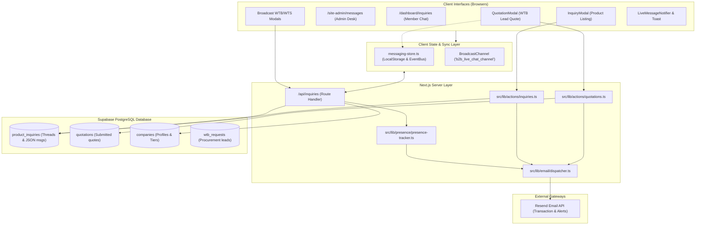
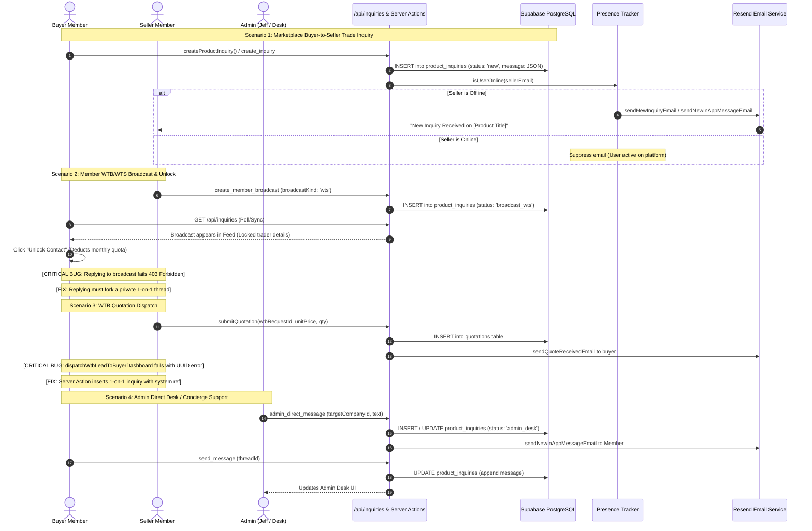
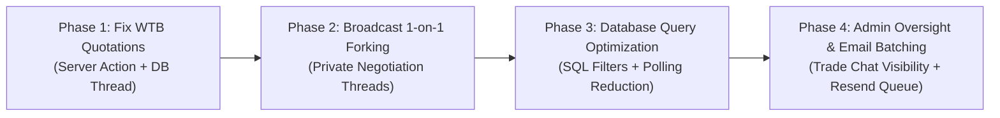

# Comprehensive System Audit: Broadcast & Private Messaging Infrastructure

**Platform:** B2B LINK  
**Status:** Audit Completed & Plan Devised  
**Scope:** Admin Broadcasts, Member Opportunity Broadcasts (WTB/WTS), Trade Inquiries, WTB Quotations, Admin Direct Desk, Presence Tracking, and Email Notifications.

---

## Executive Summary

This audit assesses every mechanism on the B2B LINK platform responsible for sending, receiving, syncing, and notifying users of messages. 

We identified **three critical architectural bugs** preventing core trade flows from working:
1. **WTB Quotation Dispatches Siloed in Seller LocalStorage:** Quotations submitted on WTB leads never reach the buyer's database record or dashboard due to a non-UUID parameter crash (`wtb-xxx`) and session identity override.
2. **Replying to Broadcasts Throws 403 Forbidden & Lacks Conversation Forking:** Counterparties cannot reply to WTB/WTS broadcasts because the API strictly guards participants. Appending to a public broadcast would leak private negotiations to all members; replies must fork a private 1-on-1 thread.
3. **Database Overwrite Race Conditions:** All messages in a thread are serialized into a single `product_inquiries.message` JSON text column, causing concurrent messages to overwrite one another.

We also identified **three high-severity performance and UI disconnects**, including unbounded 2.5-second polling of the entire platform database and an empty "Buyer & Seller Trade Chats" tab in the Admin Desk.

---

## 1. System Architecture & Message Flow Diagrams

### High-Level Messaging Architecture



---

### End-to-End Sequence Diagram: All Message Sending & Receiving Scenarios



---

## 2. In-Depth Component Analysis

### A. Admin Platform Broadcasts
- **Entrypoint:** `src/app/site-admin/messages/page.tsx` -> `POST /api/inquiries` (`action: 'create_broadcast'`).
- **Mechanics:** Admin selects an audience (`all`, `gold`, `silver`, `free`, `seller`, `buyer`). An announcement row is inserted into `product_inquiries` with `status: 'broadcast_seller'` or `'broadcast_buyer'`. 
- **Delivery:** The route queries registered users and dispatches emails via `sendNewInAppMessageEmail`.

### B. Member WTB / WTS Opportunity Broadcasts
- **Entrypoint:** `src/components/modals/BroadcastWtbModal.tsx`, `BroadcastWtsModal.tsx` -> `POST /api/inquiries` (`action: 'create_member_broadcast'`).
- **Mechanics:** Gold-tier members broadcast stock lots or buying requests. Stored in `product_inquiries` with `status: 'broadcast_wtb'` or `'broadcast_wts'`. Contact details are initially locked for non-owners.

### C. Buyer-to-Seller Marketplace Trade Inquiries
- **Entrypoint:** `src/components/modals/InquiryModal.tsx` -> `src/lib/actions/inquiries.ts:createProductInquiry` and `POST /api/inquiries` (`action: 'create_inquiry'`).
- **Mechanics:** A member inquiring about a marketplace product creates a thread in `product_inquiries` with `status: 'new'`.

### D. WTB Quotation Dispatches
- **Entrypoint:** `src/components/modals/QuotationModal.tsx` -> `src/lib/actions/quotations.ts:submitQuotation` and `src/lib/messaging/messaging-store.ts:dispatchWtbLeadToBuyerDashboard`.
- **Mechanics:** A supplier sends a price quote on a buyer's WTB lead.

### E. Admin Desk & Concierge Messaging
- **Entrypoint:** `src/app/site-admin/messages/page.tsx` (`action: 'admin_direct_message'`) and `src/app/dashboard/inquiries/page.tsx` (`action: 'contact_admin'`).
- **Mechanics:** Direct 1-on-1 thread between Jeff (Platform Desk) and a company with `status: 'admin_desk'`.

---

## 3. Detailed Audit Findings & Issues

### [CRITICAL] Issue 1: WTB Quotation Dispatch Siloed in Seller's LocalStorage
* **Files:** `src/lib/messaging/messaging-store.ts` (lines 1415–1435) & `src/app/api/inquiries/route.ts` (lines 1556–1594).
* **The Bug:** When a supplier submits a quotation via `QuotationModal.tsx`, `dispatchWtbLeadToBuyerDashboard` calls `/api/inquiries` with `action: 'create_inquiry'` and `productId: 'wtb-' + wtbRequest.id`.
  1. `product_inquiries.product_id` is a PostgreSQL `UUID` column. Non-UUID strings fail with PostgreSQL error code `22P02`.
  2. The failure is caught silently inside a `try {} catch {}` block.
  3. `create_inquiry` assigns `effectiveBuyerEmail = auth.user.email` (the seller's email). Thus, even if the insert succeeded, the seller would be recorded as both buyer and seller.
  4. The quote is saved exclusively to the seller's browser `localStorage` (`b2b_received_quotes_<buyerEmail>`).
* **Consequence:** **Buyers never see quotations in `/dashboard/inquiries`**. When the seller switches devices or clears their cache, their view of the quotation is lost forever.

### [CRITICAL] Issue 2: Replying to Broadcasts Throws 403 Forbidden & Lacks 1-on-1 Forking
* **Files:** `src/app/api/inquiries/route.ts` (lines 988–1012) & `src/app/dashboard/inquiries/page.tsx` (lines 255–282).
* **The Bug:** When a member unlocks contact on a WTB/WTS broadcast and types a message, `handleSend()` calls `send_message` targeting the broadcast's thread ID.
  1. `send_message` verifies that the caller is either the seller or the buyer of that row. For a broadcast, only the creator is a participant. All other members are rejected with **HTTP 403 Forbidden**.
  2. If the 403 check were bypassed, appending to the broadcast's row would expose private counter-offers to every user on the platform viewing that broadcast.
* **Consequence:** **Members cannot reply to broadcasts or negotiate.** A reply to a broadcast must fork a private, 1-on-1 `buyer_seller` inquiry between the replier and the broadcast publisher.

### [CRITICAL] Issue 3: Race Condition on Serialized JSON Message Column
* **Files:** `src/app/api/inquiries/route.ts` (lines 806–813, 1038–1043).
* **The Bug:** Entire chat histories are stored as serialized JSON strings inside `product_inquiries.message`.
  1. The server reads the existing string, parses it into an array, pushes the new message, and writes the string back.
  2. If two users send messages concurrently, the second write overwrites the first message.
* **Consequence:** Lost messages during rapid negotiations.

### [HIGH] Issue 4: Aggressive 2.5s Unbounded Database Polling
* **Files:** `src/app/dashboard/inquiries/page.tsx` (line 107), `src/app/site-admin/messages/page.tsx` (line 127), and `src/app/api/inquiries/route.ts` (lines 248–285).
* **The Bug:** Every 2.5 seconds, every active client polls `GET /api/inquiries`.
  1. The route executes `SELECT * FROM product_inquiries` and `SELECT * FROM companies` with **no SQL filters and no limit**, fetching all rows and filtering them in Node.js memory.
  2. With 20 active users, the database handles 8 full-table scans per second.
* **Consequence:** High database load, high server memory usage, and risk of 504 timeouts as records grow.

### [HIGH] Issue 5: Admin UI "Buyer & Seller Trade Chats" Tab Is Permanently Empty
* **Files:** `src/app/site-admin/messages/page.tsx` (lines 145–164) vs `src/app/api/inquiries/route.ts` (lines 291–300).
* **The Bug:** The Admin Messages UI includes a tab for "Buyer & Seller Trade Chats" with a badge count and mediation notes input. However, `GET /api/inquiries?role=admin` explicitly filters out all trade chats:
  ```ts
  conversations = conversations.filter(
    (c) => c.type === 'seller_admin' || c.type === 'broadcast'
  );
  ```
* **Consequence:** The trade chat counter in the admin desk is permanently 0, preventing admins from viewing or mediating trades.

### [HIGH] Issue 6: Serverless In-Memory Presence & Debounce Vulnerability
* **Files:** `src/lib/presence/presence-tracker.ts` (lines 38–52).
* **The Bug:** Presence and notification debounce queues are held in `globalThis` memory with `setTimeout`.
  1. In serverless environments (e.g., Vercel), requests hit different Lambda instances with separate memory spaces.
  2. Lambda containers freeze or terminate after returning an HTTP response, which can cause debounced timer callbacks to never execute.
* **Consequence:** False offline emails sent to users who are online, or dropped bundled notifications.

### [MEDIUM] Issue 7: Inconsistent Message Formatting (Plain Text vs. JSON Array)
* **Files:** `src/lib/actions/inquiries.ts` (line 130) vs `src/app/api/inquiries/route.ts` (lines 55–75).
* **The Bug:** The server action `createProductInquiry` writes `message: data.message.trim()` as a raw string. When `parseMessagesFromRow` fails to parse it as JSON, it falls back to creating a message with `isRead: true`.
* **Consequence:** Sellers do not receive unread indicators or blue notification dots for inquiries created via the server action.

### [MEDIUM] Issue 8: Admin Broadcast Email Storm & 100-User Cap
* **Files:** `src/app/api/inquiries/route.ts` (lines 1260–1306).
* **The Bug:**
  1. `listUsers({ page: 1, perPage: 100 })` only fetches the first 100 users. Members beyond the first 100 are omitted.
  2. Emails are dispatched in an unthrottled loop, exceeding Resend's 2–10 req/s rate limit and triggering 429 errors.
* **Consequence:** Broadcast emails fail to reach all eligible users.

### [LOW] Issue 9: Malformed PostgREST Query on Empty Email
* **Files:** `src/app/api/inquiries/route.ts` (line 801).
* **The Bug:** `.or('seller_company_id.eq.${targetCompanyId},buyer_email.ilike.${targetCompanyEmail}')` fails with a PostgREST syntax error if `targetCompanyEmail` is empty or undefined.
* **Consequence:** Fails when messaging companies that do not have a contact email recorded.

---

## 4. Remediation Plan



### Phase 1: WTB Quotation Dispatch & Thread Creation (Critical Fix 1)
1. **Automate 1-on-1 Inquiry Creation in `submitQuotation`:**
   - In `src/lib/actions/quotations.ts`, upon successful quote submission:
     - Generate a valid `product_id` using `getSystemProductId(supabase)`.
     - Insert a row into `product_inquiries` linking `seller_company_id` to the quoting supplier and `buyer_email` / `buyer_company` to the WTB requester.
     - Store the quotation details in `message` as a JSON array with `isRead: false`.
2. **Deprecate Client-Only LocalStorage Dispatch:**
   - Remove `dispatchWtbLeadToBuyerDashboard` from `QuotationModal.tsx` and route the user directly to the newly created Supabase thread.

### Phase 2: Broadcast Reply & Conversation Forking (Critical Fix 2)
1. **Introduce Conversation Forking Endpoint:**
   - When a user replies to a WTB/WTS broadcast, call `action: 'fork_broadcast_thread'`.
   - Verify the user has unlocked the contact or has permission to communicate.
   - Look up or create a private 1-on-1 thread between the replier and the broadcast owner.
   - Seed the initial message with reference to the broadcast item (`"[Re: WTB] " + broadcast.title`).
   - Redirect the active conversation in the UI to the newly created private thread.

### Phase 3: Optimize Polling & Add SQL-Level Filtering (High Fix 4)
1. **Push Filtering into Supabase SQL:**
   - For members: Query only rows where `seller_company_id = sessionCompId` OR `buyer_email = sessionEmail` OR `status IN ('broadcast_wtb', 'broadcast_wts')`.
   - Add `.limit(50)` to prevent unbounded queries.
2. **Tune Polling Intervals:**
   - Increase interval from 2.5s to 6s for active tabs.
   - Pause polling when the document is hidden (`document.visibilityState === 'hidden'`).

### Phase 4: Admin Oversight & Email Hardening (Fixes 5, 7, 8, 9)
1. **Reconcile Admin Trade Chat Tab:**
   - Allow admins to fetch trade inquiries when `tab === 'buyer_seller_chats'` or include them under an admin review permission flag.
2. **Unify Message JSON Serialization:**
   - Standardize `createProductInquiry` to format `message: JSON.stringify([initialChatMessage])` with `isRead: false`.
3. **Paginate and Throttle Broadcast Emails:**
   - Paginate `listUsers` and dispatch emails in batches of 5 with a 200ms delay to stay within Resend rate limits.
4. **Sanitize PostgREST Query:**
   - Check if `targetCompanyEmail` exists before appending `buyer_email.ilike`.

---

## 5. Verification Checklist

- [ ] **Test 1: WTB Quotation Thread Verification**  
  Submit a quotation from Seller account -> Log in as Buyer -> Verify that the quotation appears in `/dashboard/inquiries` with unread notification badge.
- [ ] **Test 2: Broadcast Reply Forking Verification**  
  Member A creates a WTS broadcast -> Member B unlocks contact and sends a quote -> Verify Member B does not receive a 403 error, a new private thread is created, and the public broadcast remains unaltered.
- [ ] **Test 3: Concurrency & Format Consistency**  
  Send an inquiry via `createProductInquiry` server action -> Verify the message format in PostgreSQL is a valid JSON array and `isRead: false`.
- [ ] **Test 4: Admin Desk Trade Chat Visibility**  
  Log in as admin -> Navigate to `/site-admin/messages` -> Click "Buyer & Seller Trade Chats" -> Verify existing trade inquiries render with accurate counts.
- [ ] **Test 5: Resend Email Rate Limiting**  
  Trigger an admin broadcast to test audience -> Confirm all recipients receive the email without HTTP 429 rejections.
